

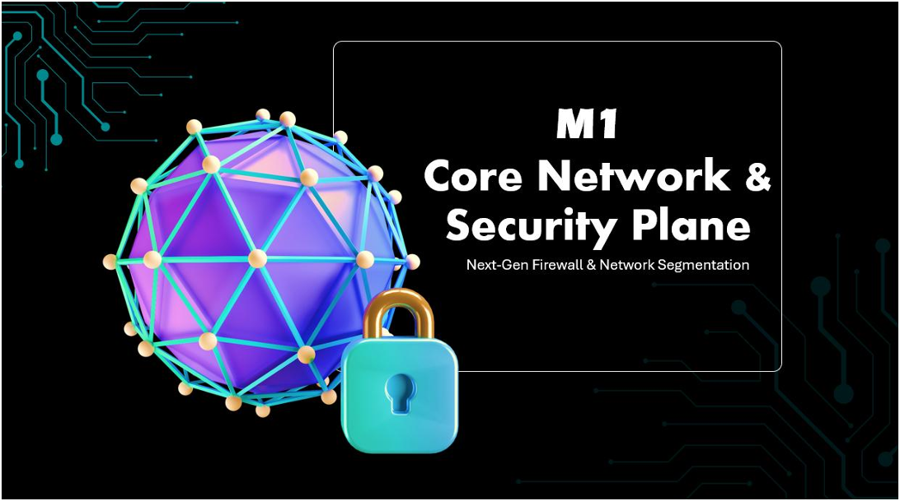

  

<h1>Machine 1 — Core Network and Security Plane</h1>
<h3>Next-Gen Firewall, Inline IPS, DNS Security, Network Monitoring and DMZ Services</h3>

 

  

<a href="#network-topology"><b>Topology</b></a> &nbsp;·&nbsp;
<a href="#network-layer"><b>Network</b></a> &nbsp;·&nbsp;
<a href="#security-and-monitoring-layer"><b>Monitoring</b></a> &nbsp;·&nbsp;
<a href="#dmz-services"><b>DMZ</b></a> &nbsp;·&nbsp;
<a href="#integration-with-other-machines"><b>Integration</b></a> &nbsp;·&nbsp;
<a href="#current-status"><b>Status</b></a>

 

---

## Executive Summary

Machine 1 is the hub of the Zero Trust UTM project. It runs the complete network security stack: edge routing, a next-generation firewall, inline IPS, DNS filtering, passive network monitoring, full packet capture and DMZ-hosted services. Machines 2 to 5 all depend on M1 for connectivity, DNS resolution and perimeter enforcement.

> All testing was performed in a private, isolated lab. All IP addresses shown are lab-only values.

 

## Network Topology

The lab network was built in GNS3, with FortiGate enforcing three zones.

  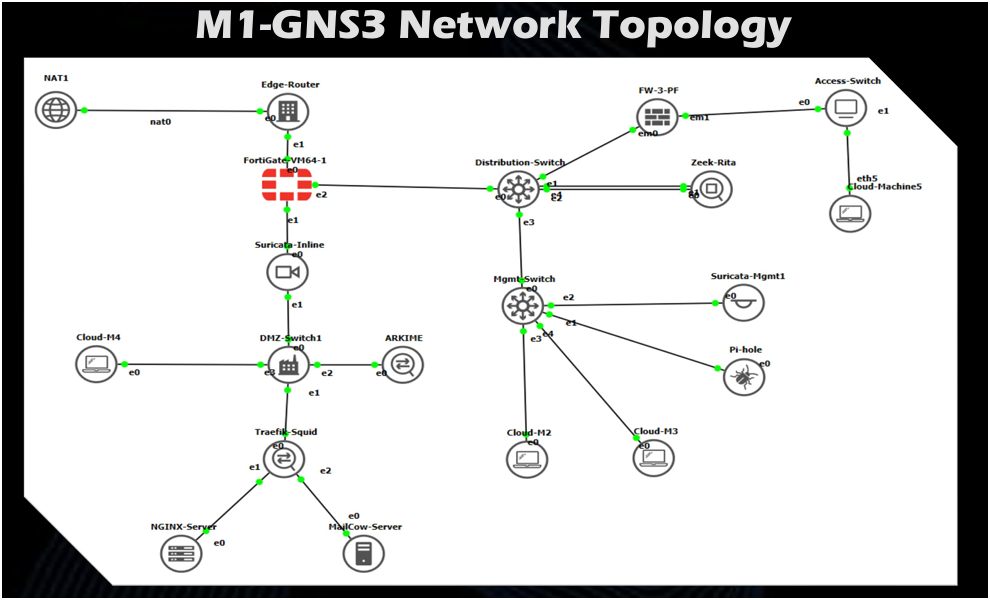 
  M1 network topology in GNS3

  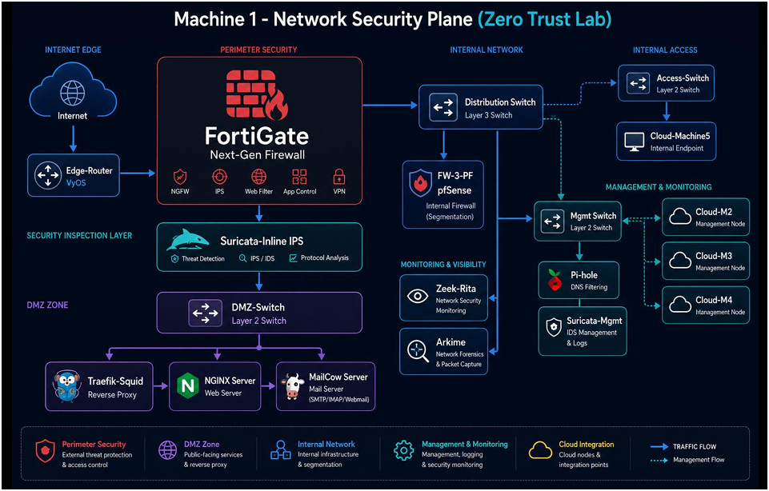 
  M1 network security plane architecture

<table>
<tr><th>Zone</th><th>FortiGate Zone</th><th>Interface</th><th>Purpose</th></tr>
<tr><td><b>WAN</b></td><td><code>WAN-ZONE</code></td><td>port1, <code>192.168.20.130/24</code></td><td>Internet-facing, intra-zone traffic blocked</td></tr>
<tr><td><b>DMZ</b></td><td><code>DMZ-ZONE</code></td><td>port2, <code>10.10.1.1/24</code></td><td>Suricata, Traefik + Squid, NGINX and MailCow</td></tr>
<tr><td><b>Internal LAN</b></td><td><code>INTERNAL-ZONE</code></td><td>port3, <code>10.10.2.1/24</code></td><td>Distribution and management switches, pfSense, access switch and management nodes</td></tr>
</table>

**Inbound path:** Internet → NAT → VyOS → FortiGate (`WAN-TO-DMZ` policy and VIPs) → Suricata → DMZ switch → Traefik + Squid → NGINX or MailCow.

 

## Network Layer

### Edge Router: VyOS

VyOS provides NAT and the WAN gateway for the whole lab, with a static route toward FortiGate. It runs as a GNS3 virtual machine. A ping to Google DNS (`8.8.8.8`) returned round-trip times of about 49 to 53 ms.

<table>
<tr><th>Interface</th><th>Address</th><th>Role</th></tr>
<tr><td><code>eth0</code></td><td><code>192.168.42.72/24</code></td><td>WAN</td></tr>
<tr><td><code>eth1</code></td><td><code>10.0.0.1/30</code></td><td>Link to FortiGate</td></tr>
</table>

  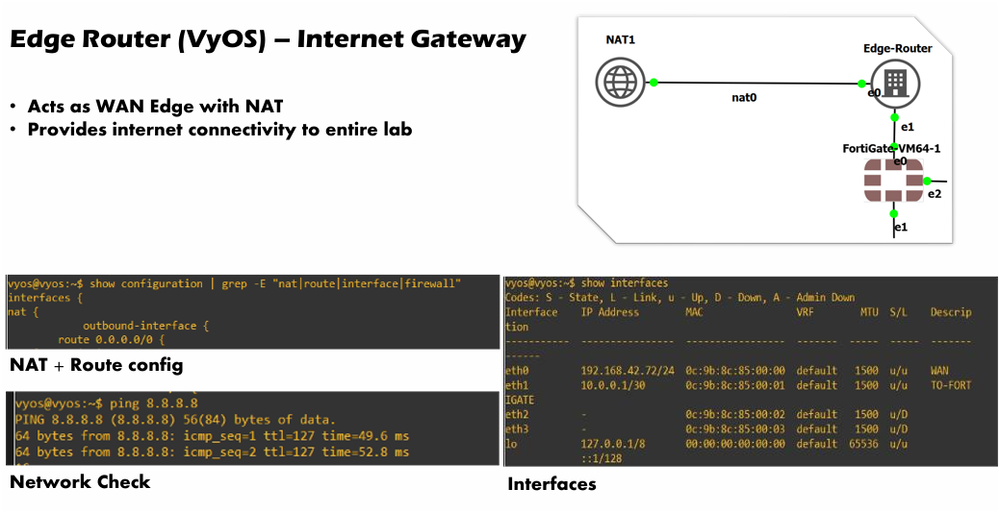

### FortiGate: Next-Generation Firewall

FortiGate VM64 is the primary perimeter control. It provides stateful inspection, IPS, SSL deep inspection, web filtering, VIP-based port forwarding and zone-based policies.

<table>
<tr><th>Feature</th><th>Configuration</th></tr>
<tr><td><b>Hostname</b></td><td><code>FW-1-FOR</code></td></tr>
<tr><td><b>DNS</b></td><td>Primary <code>8.8.8.8</code>, secondary <code>1.1.1.1</code></td></tr>
<tr><td><b>Default route</b></td><td><code>0.0.0.0/0</code> via <code>10.0.0.1</code></td></tr>
<tr><td><b>Admin hardening</b></td><td>HTTPS on 8443, SSH on 2222, 10-minute idle timeout, concurrent sessions disabled</td></tr>
<tr><td><b>IPS profile</b></td><td><code>UTM-IPS-PROFILE</code>, 2,533 signatures, blocks critical, high and medium severity attacks</td></tr>
<tr><td><b>SSL inspection</b></td><td><code>custom-deep-inspection</code>, full inspection, blocks malicious, untrusted, expired and revoked certificates</td></tr>
<tr><td><b>Web filter</b></td><td>Flow-based, safe search enforced, proxy avoidance and hacking category blocked</td></tr>
<tr><td><b>Policy</b></td><td><code>WAN-TO-DMZ</code>: SMTP, HTTP and HTTPS to the VIPs, with antivirus, IPS and certificate inspection (the <code>custom-deep-inspection</code> profile is defined but not applied to this policy), all sessions logged</td></tr>
</table>

<table>
<tr><th>Virtual IP</th><th>External</th><th>Internal</th><th>Purpose</th></tr>
<tr><td><code>VIP-NGINX</code></td><td><code>:80</code></td><td><code>10.10.1.10:80</code></td><td>HTTP to NGINX</td></tr>
<tr><td><code>VIP-NGINX-HTTPs</code></td><td><code>:443</code></td><td><code>10.10.1.10:443</code></td><td>HTTPS to NGINX via Traefik + Squid</td></tr>
<tr><td><code>VIP-MAILCOW</code></td><td><code>:25</code></td><td><code>10.10.1.11:25</code></td><td>SMTP to MailCow via Traefik + Squid</td></tr>
</table>

  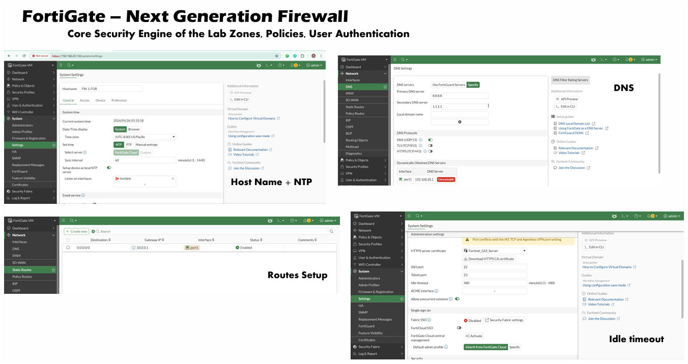 
  System settings: hostname, NTP, DNS, routes and idle timeout

  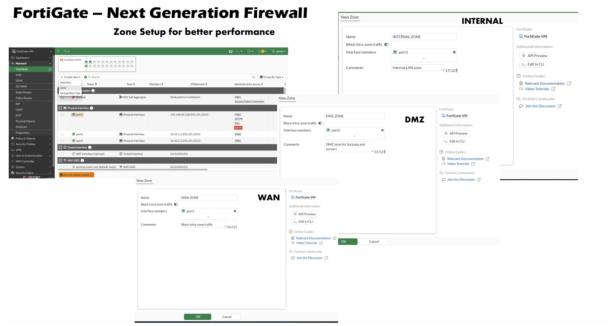 
  WAN, DMZ and internal zones

  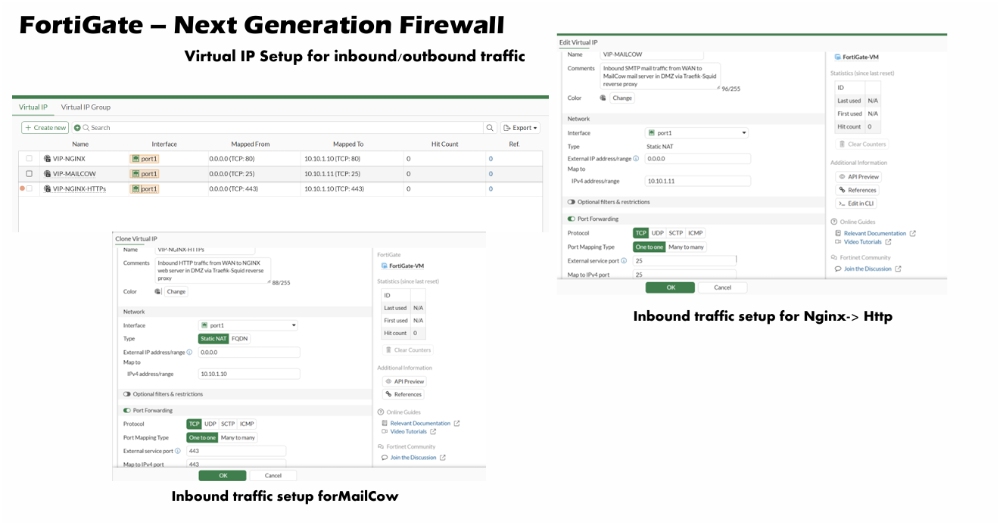 
  Virtual IPs for NGINX and MailCow

  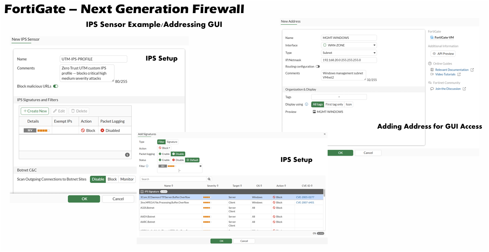 
  IPS sensor and GUI access address

  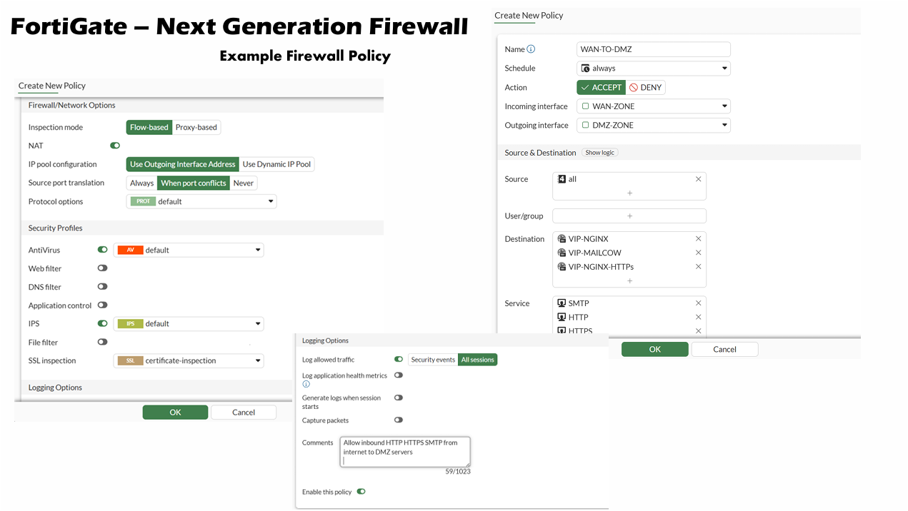 
  Example firewall policy

  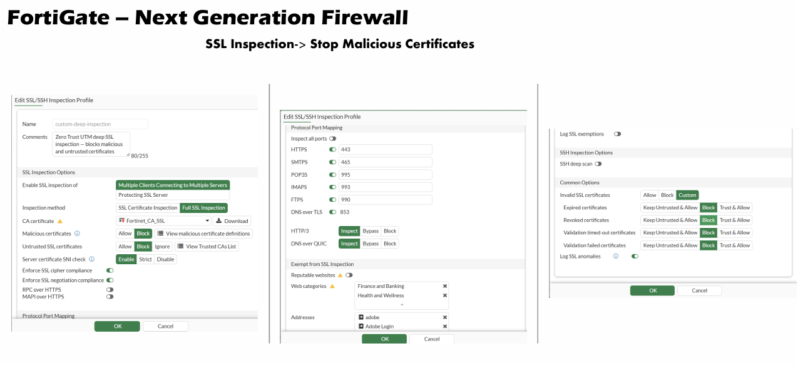 
  SSL inspection that stops malicious certificates

  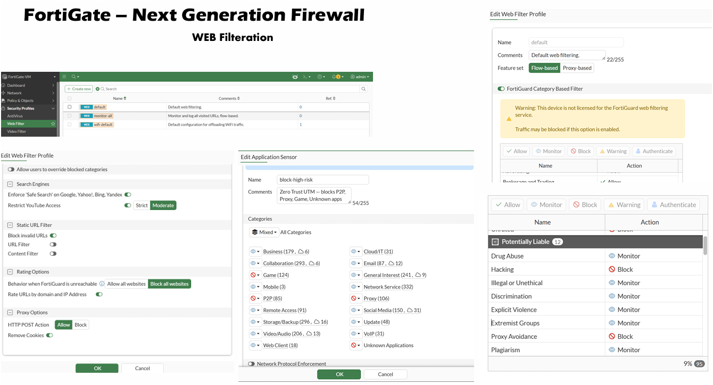 
  Web filtering

  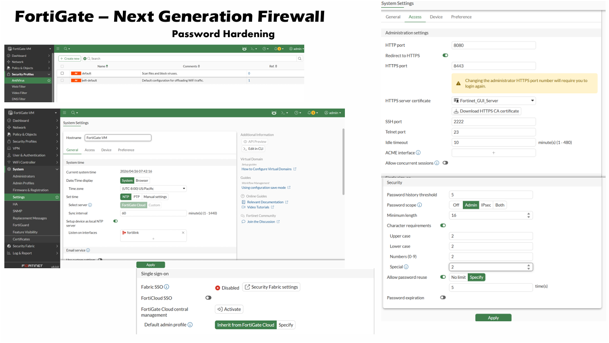 
  Password hardening

### Suricata: Inline IPS

Suricata is placed inline between the FortiGate DMZ interface and the DMZ switch, using AF_PACKET. A second Suricata instance monitors the management VLAN (`10.10.3.0/24`) passively on `ens3` and writes to `fast.log` and `eve.json`.

  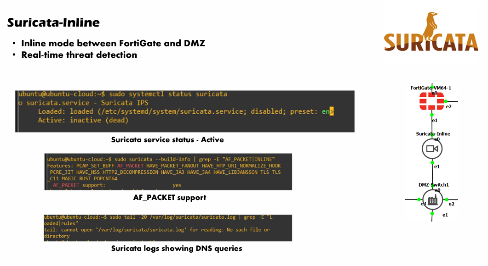

  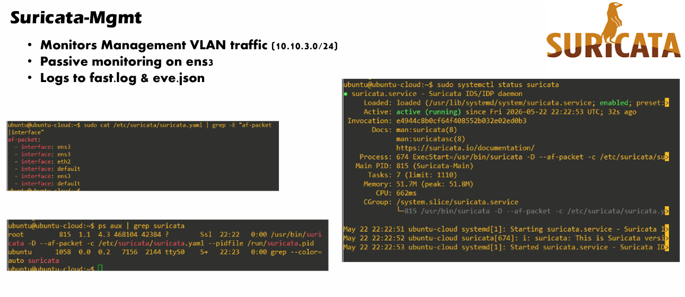

### DMZ Switch, Distribution Switch and Management Switch

<table>
<tr><th>Device</th><th>Role</th><th>Configuration</th></tr>
<tr><td><b>DMZ-Switch1</b></td><td>Layer 2 bridge for the DMZ</td><td>Bridge <code>dmz-br</code>, STP disabled, members <code>ens3</code> to <code>ens6</code></td></tr>
<tr><td><b>Distribution Switch</b></td><td>Layer 3 switching for internal segments</td><td>Bridge <code>br0</code></td></tr>
<tr><td><b>Management Switch</b></td><td>Management VLAN</td><td><code>br0</code> at <code>10.10.2.3/24</code>, gateway <code>10.10.2.1</code>, VLAN 1</td></tr>
</table>

  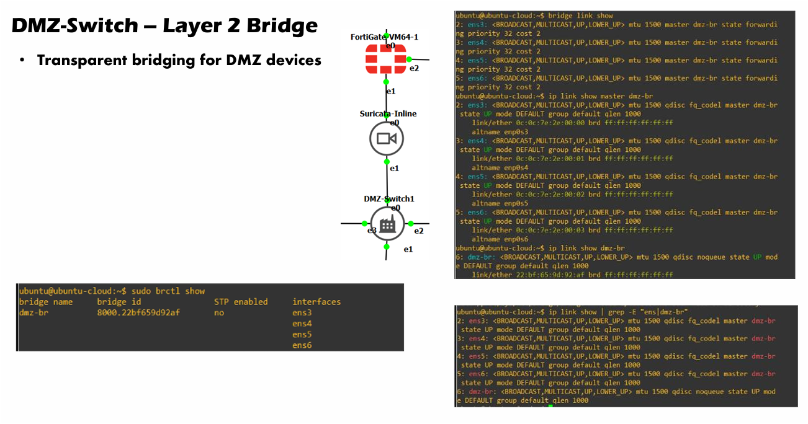

  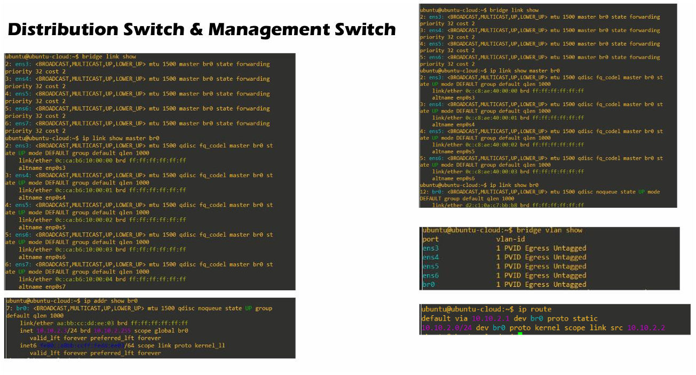

 

## Security and Monitoring Layer

<table>
<tr><th>Component</th><th>Role</th><th>Key detail</th></tr>
<tr><td><b>Pi-hole</b></td><td>DNS security</td><td>Primary DNS for internal and DMZ networks, blocks ads, trackers and malware domains, <code>pihole-FTL</code> running with blocking enabled, backup DNS <code>8.8.8.8</code></td></tr>
<tr><td><b>Zeek + RITA</b></td><td>Network security monitoring</td><td>Zeek captures traffic passively on <code>ens4</code>, RITA analyses Zeek logs for beaconing and DNS anomalies, MongoDB backend, database <code>mgmt-network</code></td></tr>
<tr><td><b>Arkime</b></td><td>Full packet capture</td><td>Captures and indexes packets through Elasticsearch for session reconstruction</td></tr>
<tr><td><b>Traefik + Squid</b></td><td>Reverse and forward proxy</td><td>Traefik routes inbound traffic on 80, 443 and 8080, Squid forwards outbound traffic on 3128</td></tr>
</table>

  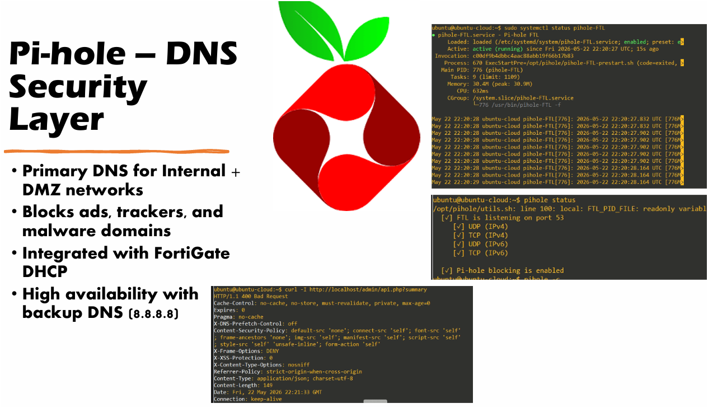

  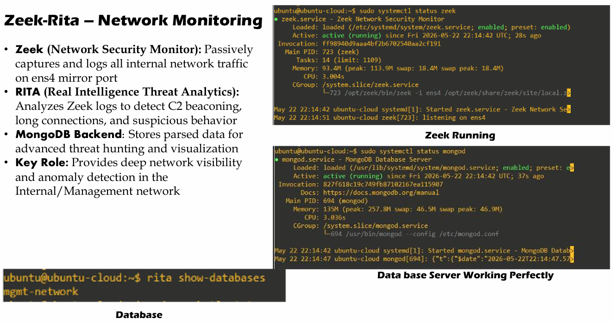

  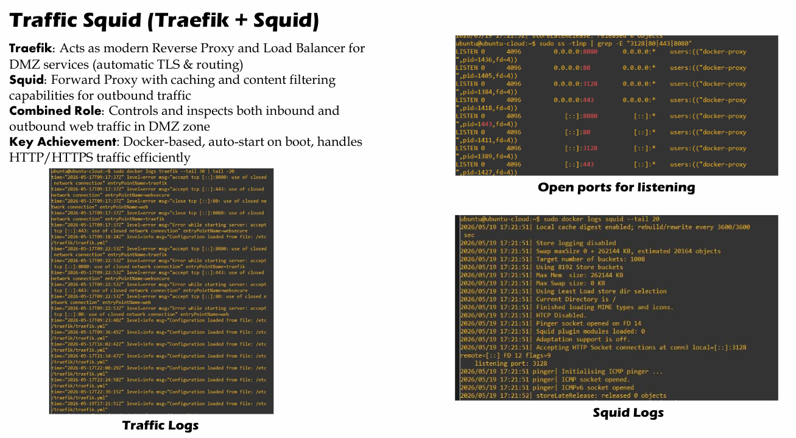

  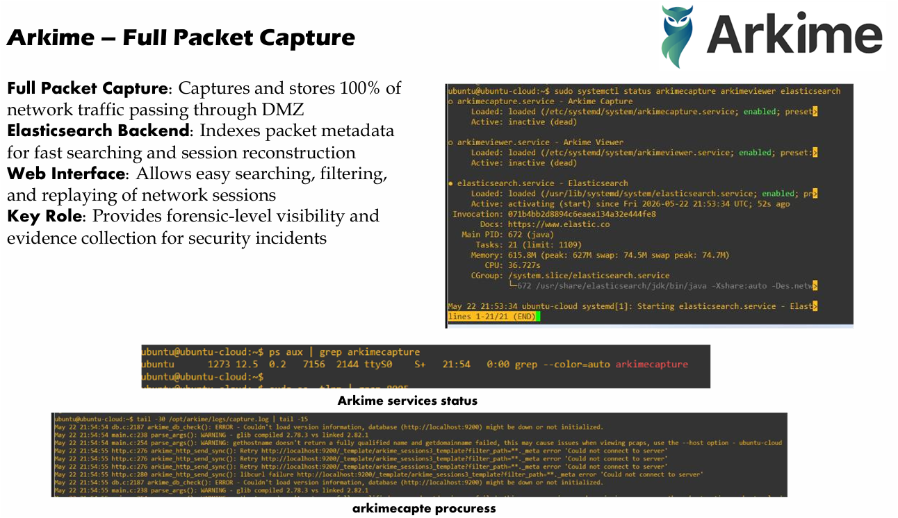

 

## DMZ Services

<table>
<tr><th>Service</th><th>Detail</th></tr>
<tr><td><b>NGINX</b></td><td>Web server and secondary reverse proxy at <code>10.10.1.10</code>, nginx 1.26.0, listening on 80 and 443, configuration test successful, HTTP 200 response</td></tr>
<tr><td><b>MailCow</b></td><td>Dockerized mail stack at <code>10.10.1.11</code> providing SMTP, IMAP, webmail and administration, with Postfix, Dovecot, Rspamd and ClamAV containers</td></tr>
</table>

  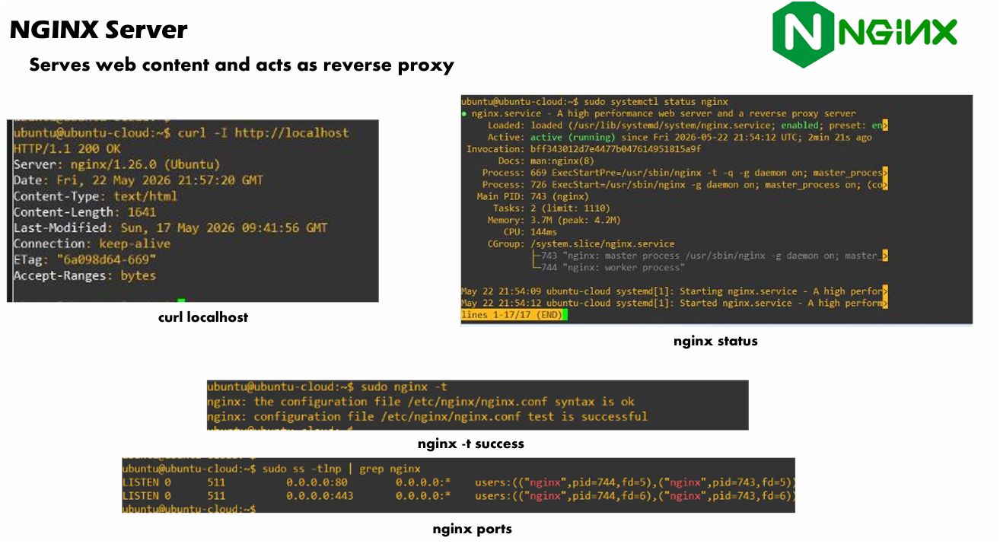

  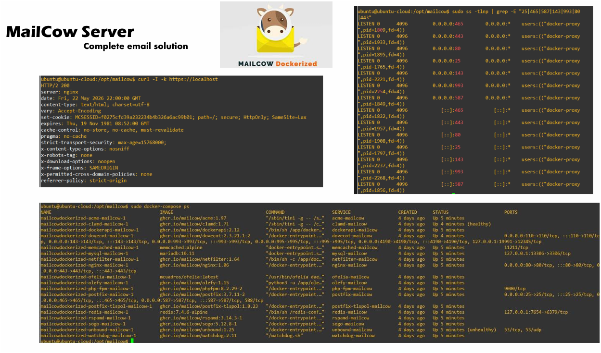

 

## Integration with Other Machines

<table>
<tr><th>Machine</th><th>Integration</th></tr>
<tr><td><b>M2 Identity</b></td><td>FreeRADIUS for 802.1X, TACACS+ for FortiGate admin, certificates for FortiGate, MailCow and NGINX TLS, LDAP and AD for identity-based policies</td></tr>
<tr><td><b>M3 Intelligence</b></td><td>Zeek logs, Suricata alerts and FortiGate syslog sent to the SIEM, Arkime captures available for forensics, SOAR blocks IPs on FortiGate and domains on Pi-hole</td></tr>
<tr><td><b>M4 Deception</b></td><td>Honeypots reachable through FortiGate policy, blocks fed back from SOAR</td></tr>
<tr><td><b>M5 Endpoint</b></td><td>Endpoint traffic passes the FortiGate web filter, DNS goes through Pi-hole</td></tr>
</table>

 

## Current Status

| Component | Status at capture time |
| --------- | ---------------------- |
| Suricata inline | Installed and enabled, AF_PACKET support confirmed, inline interface assignment pending |
| Arkime | Installed and enabled, capture and viewer waiting for Elasticsearch to finish starting |
| Suricata management | Running, passive monitoring on `ens3` |
| FortiGate web filter | Configured, FortiGuard licence warning shown, so category filtering is not verified |
| MailCow | Running, `unbound-mailcow` reported unhealthy in the container list |
| All other components | Running, as shown in the screenshots |

 

## Lab Environment

| | |
|---|---|
| **Platform** | GNS3 virtual network on M1 (24 GB RAM) |
| **Firewall** | FortiGate VM64, pfSense internal firewall |
| **Scope** | Isolated lab only |

 

## Full Report

The complete configuration evidence is in the project report:

📄 **[Zero-Trust-UTM-Report.pdf](../docs/Zero-Trust-UTM-Report.pdf)**

 

⬅ <a href="../"><b>Back to Main Repository</b></a>

