

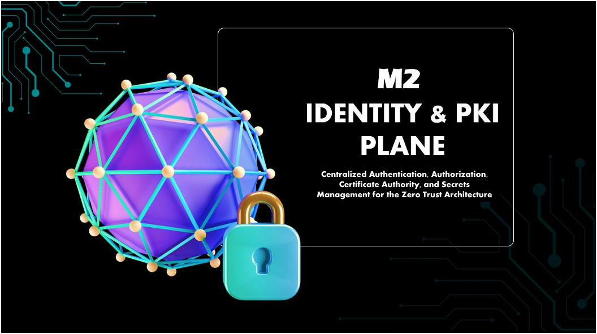

  

<h1>Machine 2 — Identity and PKI Plane</h1>
<h3>Centralized Authentication, Authorization, Certificate Authority and Secrets Management</h3>

 

  

<a href="#architecture"><b>Architecture</b></a> &nbsp;·&nbsp;
<a href="#virtual-machines"><b>VMs</b></a> &nbsp;·&nbsp;
<a href="#data-flows"><b>Flows</b></a> &nbsp;·&nbsp;
<a href="#hardening-and-verification"><b>Hardening</b></a> &nbsp;·&nbsp;
<a href="#integration-with-other-machines"><b>Integration</b></a>

 

---

## Executive Summary

Machine 2 is the identity and PKI plane of the Zero Trust UTM project. It is the central hub for authentication, authorization, certificate issuance and secrets management across all five machines. No user, service or device reaches a resource without passing through the M2 identity pipeline.

M2 provides SSO through Keycloak (OIDC and SAML), certificates through Step-CA and EJBCA, dynamic secrets through HashiCorp Vault, 802.1X access control through FreeRADIUS, Kerberos authentication, privileged access management through Conjur, a zero-trust access gateway through Teleport, attack path analysis through BloodHound and service discovery through Consul.

> All testing was performed in a private, isolated lab. All IP addresses shown are lab-only values.

 

## Architecture

  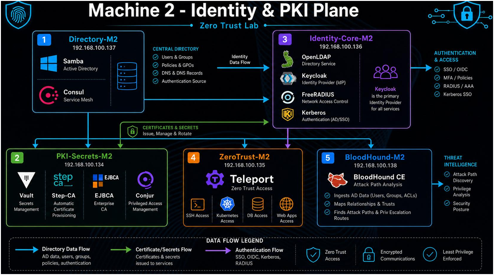 
  M2 identity and PKI plane architecture

  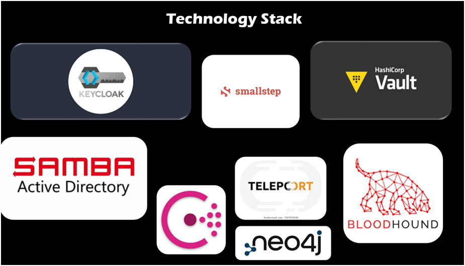 
  Technology stack

 

## Virtual Machines

<table>
<tr><th>VM</th><th>IP Address</th><th>Services</th><th>Role</th></tr>
<tr><td><b>Directory-M2</b></td><td><code>192.168.100.137</code></td><td>Samba AD, Consul server</td><td>Domain controller for <code>zerotrust.lab</code> and service mesh hub</td></tr>
<tr><td><b>PKI-Secrets-M2</b></td><td><code>192.168.100.134</code></td><td>Vault, Step-CA, EJBCA, Conjur</td><td>Certificates, secrets and privileged access</td></tr>
<tr><td><b>Identity-Core-M2</b></td><td><code>192.168.100.136</code></td><td>Keycloak, OpenLDAP, FreeRADIUS, Kerberos KDC</td><td>Identity provider and network authentication</td></tr>
<tr><td><b>ZeroTrust-M2</b></td><td><code>192.168.100.135</code></td><td>Teleport</td><td>Zero-trust access gateway with session recording</td></tr>
<tr><td><b>BloodHound-M2</b></td><td><code>192.168.100.138</code></td><td>BloodHound CE, Neo4j, PostgreSQL</td><td>Attack path analysis</td></tr>
</table>

### Directory-M2: Samba AD and Consul

Samba Active Directory manages users, groups, policies and DNS for `zerotrust.lab`. The Consul server and four clients form a service mesh in the `zerotrust-lab` datacenter, and all 5 nodes report alive.

  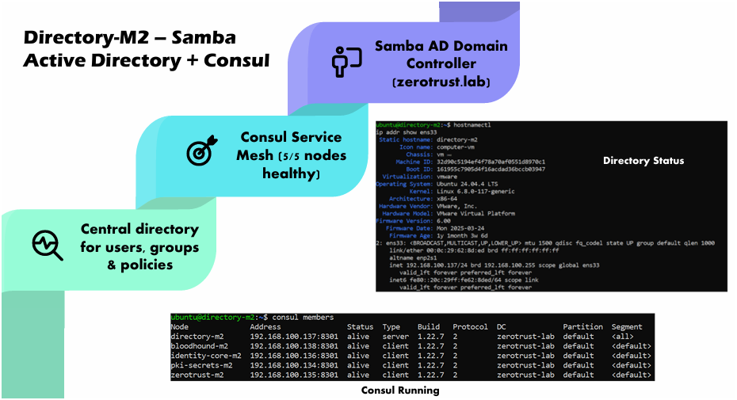

### PKI-Secrets-M2: Vault, Step-CA, EJBCA and Conjur

Step-CA issues TLS, mTLS and device certificates through ACME, EJBCA acts as the enterprise CA, Vault delivers dynamic secrets, and Conjur handles privileged access secrets.

  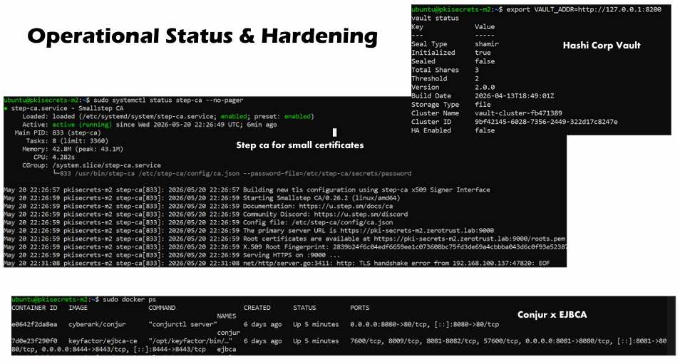

### Identity-Core-M2: Keycloak, OpenLDAP, FreeRADIUS and Kerberos

Keycloak is the primary identity provider, with a `zerotrust` realm backed by OpenLDAP. FreeRADIUS provides 802.1X authentication and Kerberos provides ticket-based SSO.

  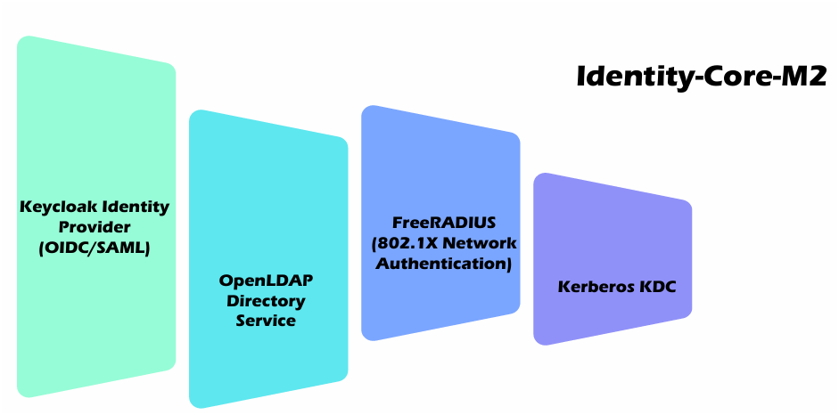

  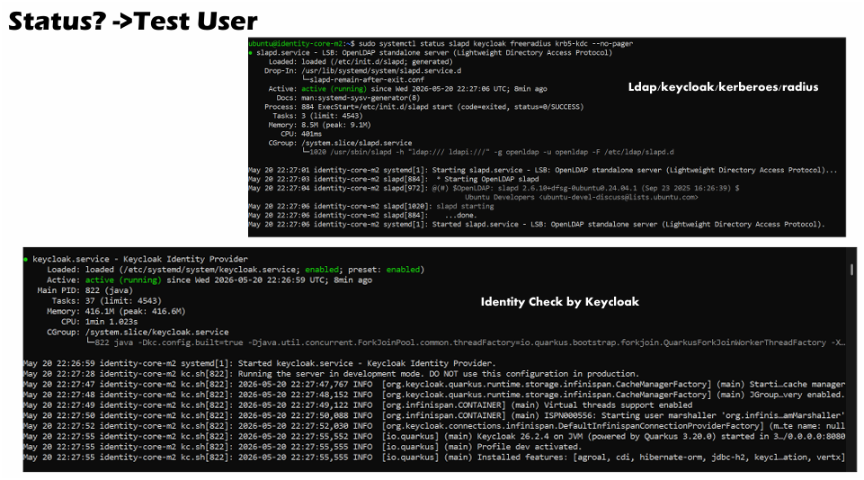 
  Service checks and test user

  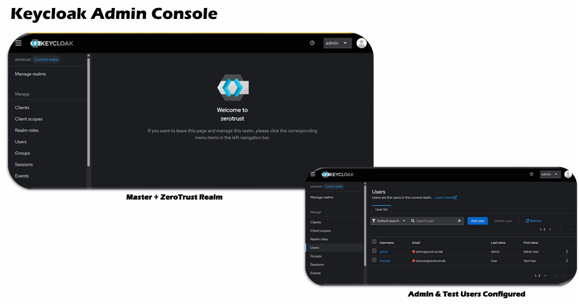 
  Keycloak admin console with the master and ZeroTrust realms

### ZeroTrust-M2: Teleport

Teleport is the access gateway for SSH, Kubernetes, database and web access. It enforces MFA, least privilege and just-in-time access, and records sessions for audit.

  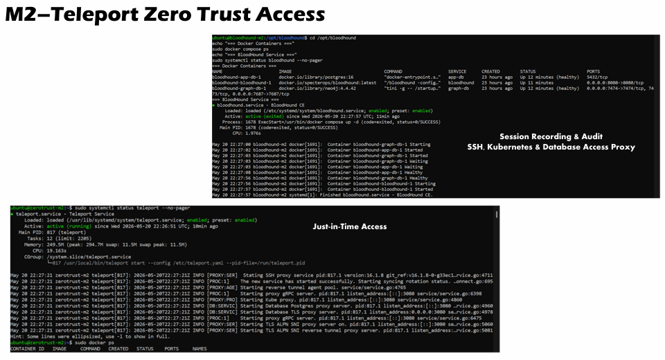

### BloodHound-M2: BloodHound CE and Neo4j

BloodHound CE maps Active Directory relationships in a Neo4j graph database to find attack paths and privilege escalation routes.

  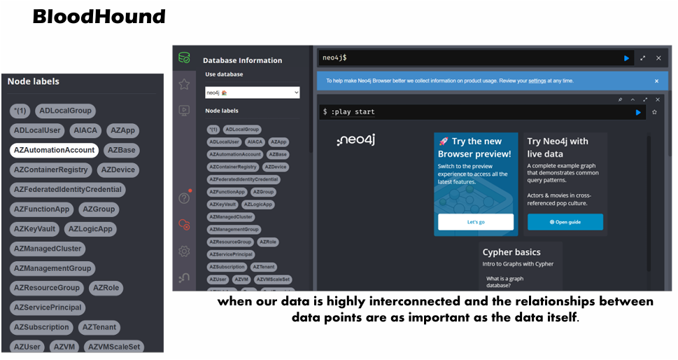

### Consul Service Mesh

  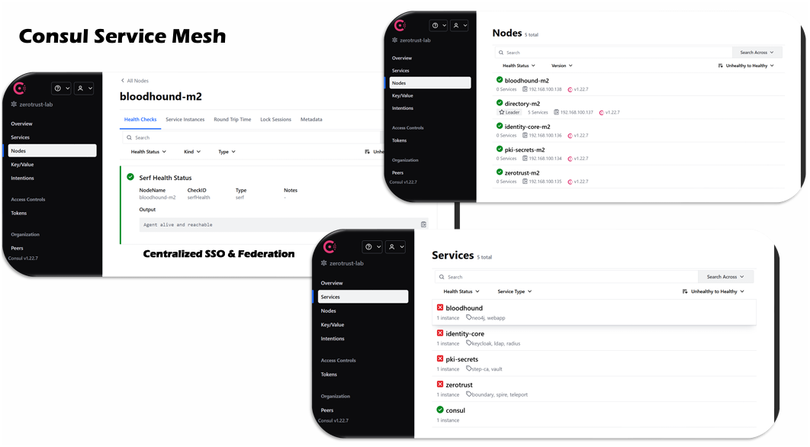

 

## Data Flows

  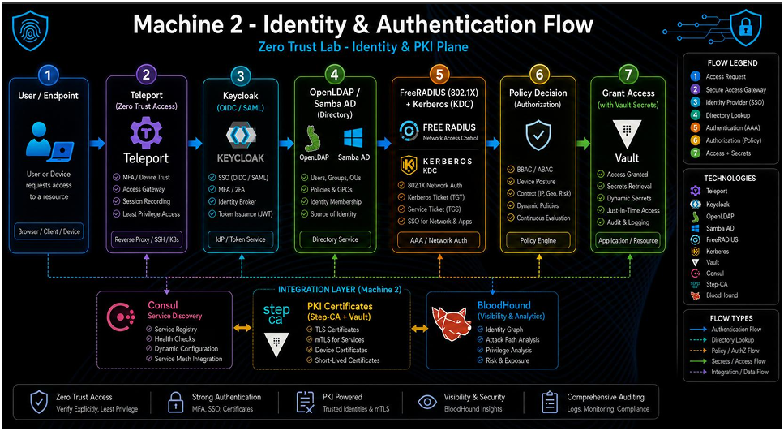 
  Identity and authentication flow

  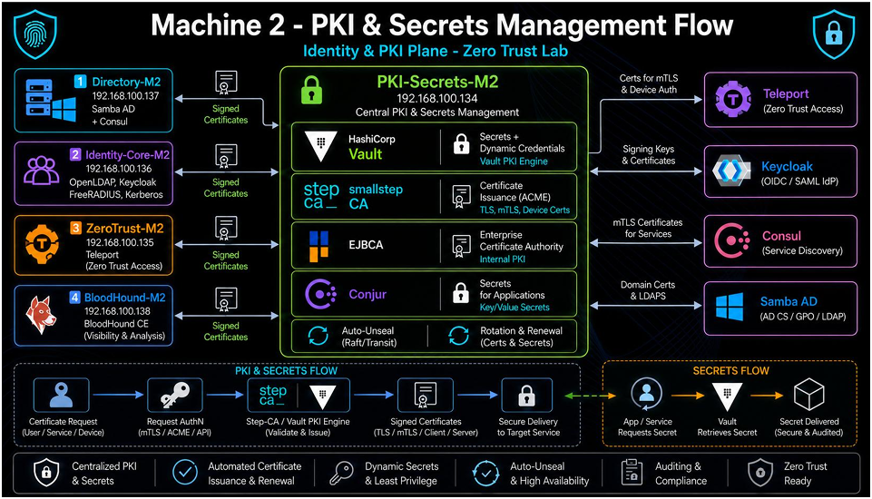 
  PKI and secrets management flow

<table>
<tr><th>Flow</th><th>Path</th></tr>
<tr><td><b>Authentication</b></td><td>User or device → Teleport → Keycloak (OIDC/SAML, JWT) → OpenLDAP or Samba AD → FreeRADIUS or Kerberos → policy decision → Vault delivers secrets</td></tr>
<tr><td><b>Certificates</b></td><td>Certificate request (mTLS, ACME or API) → Step-CA, EJBCA or Vault PKI signs → certificate delivered with auto-renewal</td></tr>
<tr><td><b>Secrets</b></td><td>Application calls the Vault API → token and ACL check → secret or dynamic credential returned with a TTL and audit log</td></tr>
</table>

 

## Hardening and Verification

A connectivity script run from `directory-m2` checked all 11 service endpoints: 11 passed, 0 failed.

  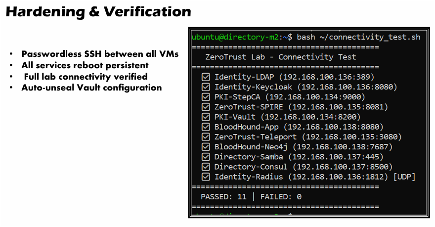

<table>
<tr><th>Measure</th><th>Detail</th></tr>
<tr><td><b>Passwordless SSH</b></td><td>Configured between all VMs for automation</td></tr>
<tr><td><b>Service persistence</b></td><td>Keycloak, Step-CA, Teleport, BloodHound, Consul, FreeRADIUS, slapd and krb5-kdc start on boot through systemd</td></tr>
<tr><td><b>Vault</b></td><td>Shamir seal with 3 shares and a threshold of 2</td></tr>
<tr><td><b>mTLS</b></td><td>Inter-service traffic secured with certificates issued by Step-CA</td></tr>
<tr><td><b>Known limitations</b></td><td>Keycloak runs in development mode, and the Consul services view shows four service checks as unhealthy while all 5 nodes are alive</td></tr>
<tr><td><b>Least privilege</b></td><td>Teleport enforces role-based access for SSH, Kubernetes and database sessions</td></tr>
</table>

 

## Integration with Other Machines

<table>
<tr><th>Machine</th><th>Integration</th><th>Protocol</th></tr>
<tr><td><b>M1 Network</b></td><td>FortiGate uses FreeRADIUS for 802.1X, TACACS+ for admin AAA, Step-CA for EAP-TLS, Keycloak for management SSO</td><td>RADIUS, TACACS+, EAP-TLS, OIDC/SAML</td></tr>
<tr><td><b>M3 Intelligence</b></td><td>Keycloak, RADIUS, Kerberos, Teleport and Vault logs sent to the Wazuh SIEM</td><td>Syslog, Kafka</td></tr>
<tr><td><b>M4 Deception</b></td><td>Vault issues honeypot tokens, Keycloak provides management SSO</td><td>Vault API, OIDC</td></tr>
<tr><td><b>M5 Endpoint</b></td><td>Endpoints authenticate with Step-CA certificates and get secrets from Vault</td><td>EAP-TLS, Vault API</td></tr>
</table>

 

## Lab Environment

| | |
|---|---|
| **Platform** | 5 VMs on M2 (16 GB RAM), Ubuntu 24.04 LTS on VMware |
| **Domain** | `zerotrust.lab` |
| **Scope** | Isolated lab only |

 

## Full Report

📄 **[Zero-Trust-UTM-Report.pdf](../docs/Zero-Trust-UTM-Report.pdf)**

 

⬅ <a href="../"><b>Back to Main Repository</b></a>

