

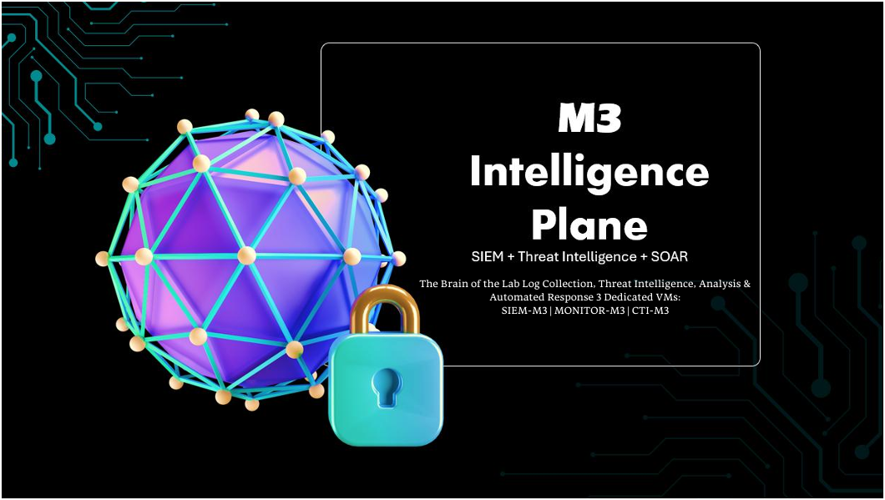

  

<h1>Machine 3 — Intelligence and SOAR Plane</h1>
<h3>SIEM, Threat Intelligence and Automated Response</h3>

 

  

<a href="#architecture"><b>Architecture</b></a> &nbsp;·&nbsp;
<a href="#log-pipeline"><b>Pipeline</b></a> &nbsp;·&nbsp;
<a href="#cti-m3-tools"><b>CTI Tools</b></a> &nbsp;·&nbsp;
<a href="#soar-workflows"><b>SOAR</b></a> &nbsp;·&nbsp;
<a href="#integration-with-other-machines"><b>Integration</b></a>

 

---

## Executive Summary

Machine 3 is the intelligence and SOAR plane of the Zero Trust UTM project, the brain of the lab. It collects logs from every machine, enriches them with threat intelligence, detects threats in real time and orchestrates automated responses. M1 enforces network policy and M2 manages identity, while M3 makes the system self-aware and self-defending.

M3 has the highest RAM allocation in the cluster (32 GB of 104 GB) because it runs the heaviest stack: OpenSearch, Kafka with 48 topics, Logstash pipelines, Wazuh, MISP, TheHive, Cortex, IntelOwl, Shuffle and a local LLM-based dark web tool.

> All testing was performed in a private, isolated lab. All IP addresses shown are lab-only values.

 

## Architecture

  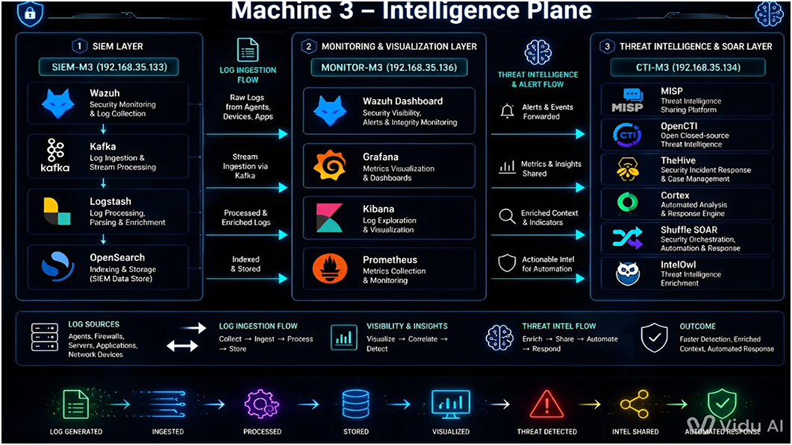 
  M3 intelligence plane: three VMs and their data flows

<table>
<tr><th>VM</th><th>IP Address</th><th>Role</th><th>Components</th></tr>
<tr><td><b>SIEM-M3</b></td><td><code>192.168.35.133</code></td><td>Log collection and event management</td><td>Wazuh Manager 4.14.5, Kafka, Logstash, OpenSearch</td></tr>
<tr><td><b>MONITOR-M3</b></td><td><code>192.168.35.136</code></td><td>Visualization and monitoring</td><td>Wazuh Dashboard, Grafana, Kibana, Prometheus</td></tr>
<tr><td><b>CTI-M3</b></td><td><code>192.168.35.134</code></td><td>Threat intelligence and SOAR</td><td>MISP, OpenCTI, TheHive, Cortex, Shuffle, IntelOwl, SpiderFoot, Dark Web CTI tool</td></tr>
</table>

 

## Log Pipeline

  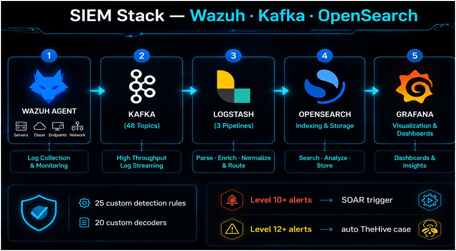 
  Wazuh, Kafka, Logstash, OpenSearch and Grafana

<table>
<tr><th>Stage</th><th>What happens</th></tr>
<tr><td><b>1. Collect</b></td><td>Wazuh agents, FortiGate syslog, Suricata, Zeek, honeypots and application logs</td></tr>
<tr><td><b>2. Ingest</b></td><td>Apache Kafka streams logs through 48 topics</td></tr>
<tr><td><b>3. Process</b></td><td>Logstash parses and tags events through 3 pipelines and adds GeoIP data</td></tr>
<tr><td><b>4. Store</b></td><td>OpenSearch indexes the enriched logs</td></tr>
<tr><td><b>5. Visualize</b></td><td>Wazuh Dashboard, Kibana and Grafana on MONITOR-M3</td></tr>
<tr><td><b>6. Detect</b></td><td>25 custom Wazuh rules and 20 custom decoders; level 10+ alerts trigger SOAR, level 12+ create TheHive cases</td></tr>
</table>

  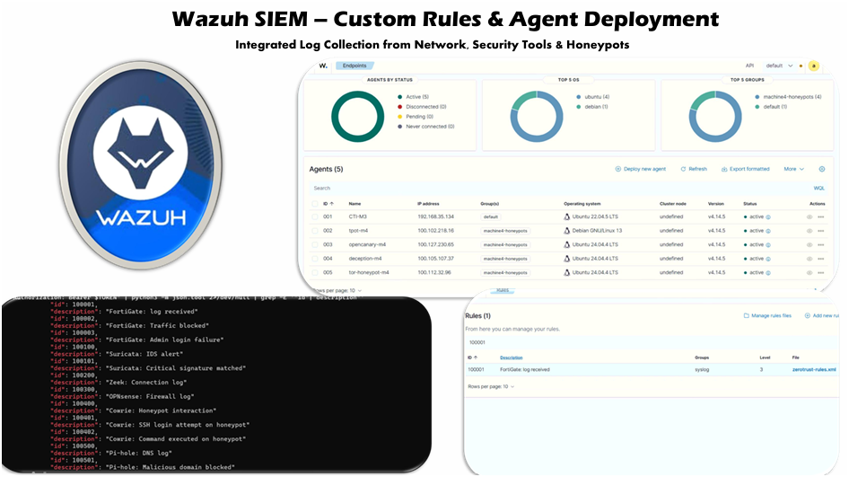 
  Wazuh custom rules and agent deployment

  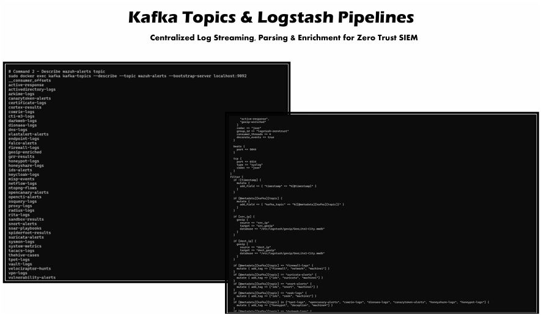 
  Kafka topics and Logstash pipelines

 

## CTI-M3 Tools

  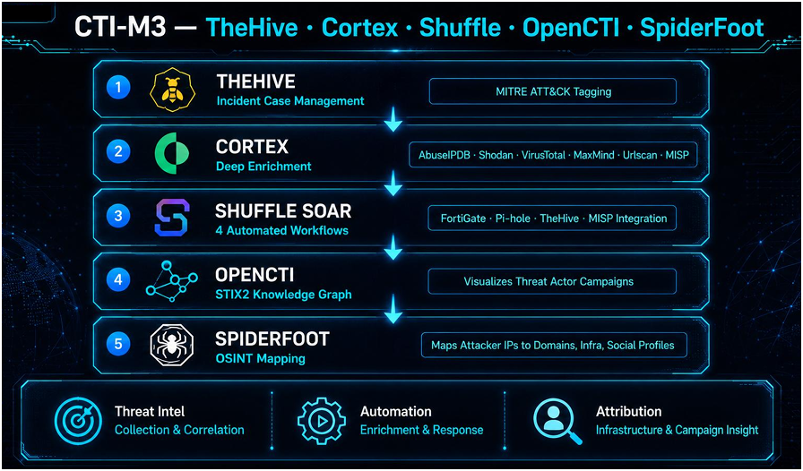

<table>
<tr><th>Tool</th><th>Role</th><th>Detail</th></tr>
<tr><td><b>MISP</b> 2.5.37</td><td>Threat intelligence sharing</td><td>Central IOC repository with automated feeds such as CIRCL, Botvrij, Emerging Threats and Tor exit nodes</td></tr>
<tr><td><b>IntelOwl</b> 6.6.1</td><td>Observable enrichment</td><td>80 analyzers and 6 connectors, including MISP and OpenCTI</td></tr>
<tr><td><b>SpiderFoot</b></td><td>Automated OSINT</td><td>Target analysis with four scan modes</td></tr>
<tr><td><b>TheHive</b> 4.0.0-1</td><td>Case management</td><td>Alerts and cases created from MISP, with MITRE ATT&amp;CK tagging</td></tr>
<tr><td><b>Cortex</b> 4.0.0-1</td><td>Analysis engine</td><td>Analyzers such as AbuseIPDB, Shodan, VirusTotal, MaxMind and URLscan</td></tr>
<tr><td><b>Shuffle</b></td><td>SOAR</td><td>Webhook-triggered playbooks</td></tr>
<tr><td><b>OpenCTI</b></td><td>Knowledge graph</td><td>STIX2 view of threat actor campaigns</td></tr>
<tr><td><b>Dark Web CTI tool</b></td><td>Dark web OSINT</td><td>Custom tool using Llama-3.3-70b through a local Ollama instance with 4 scraping threads</td></tr>
</table>

  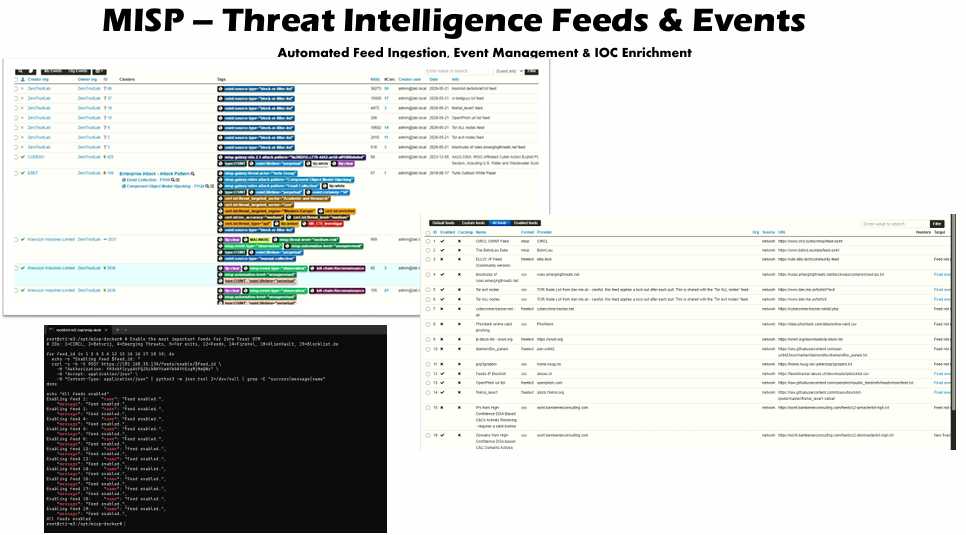 
  MISP threat intelligence feeds and events

  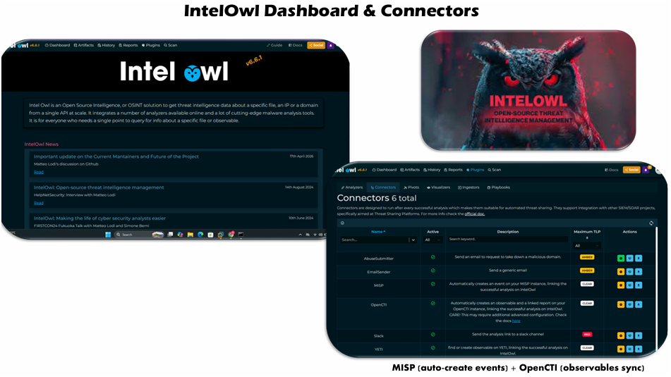 
  IntelOwl dashboard and connectors

  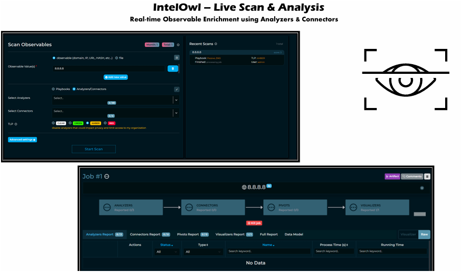 
  IntelOwl live scan and analysis

  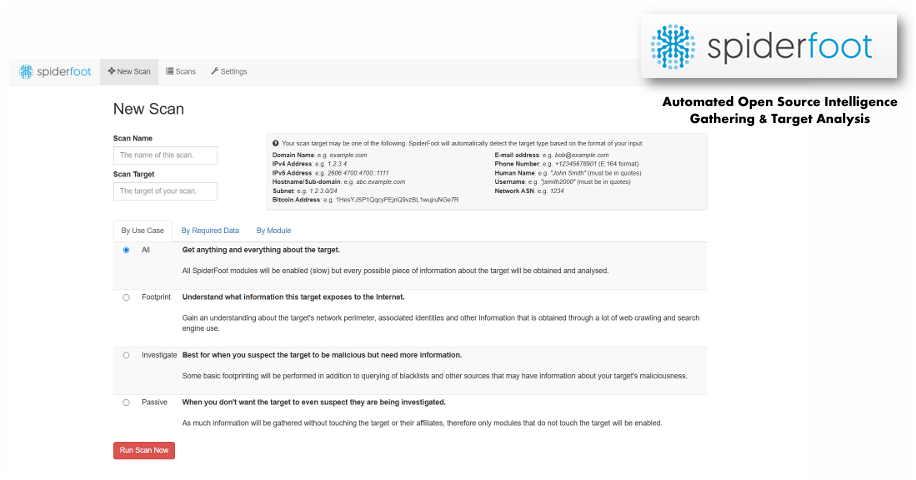

  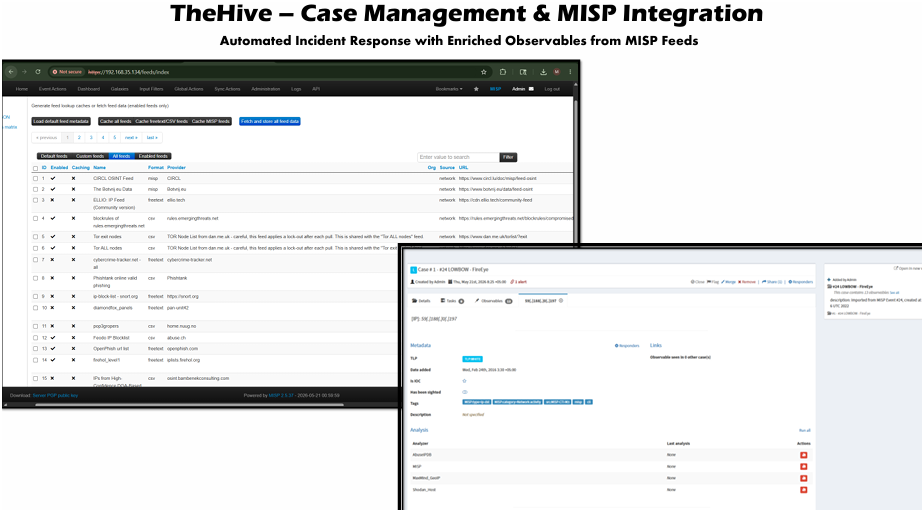 
  TheHive case management with MISP integration

  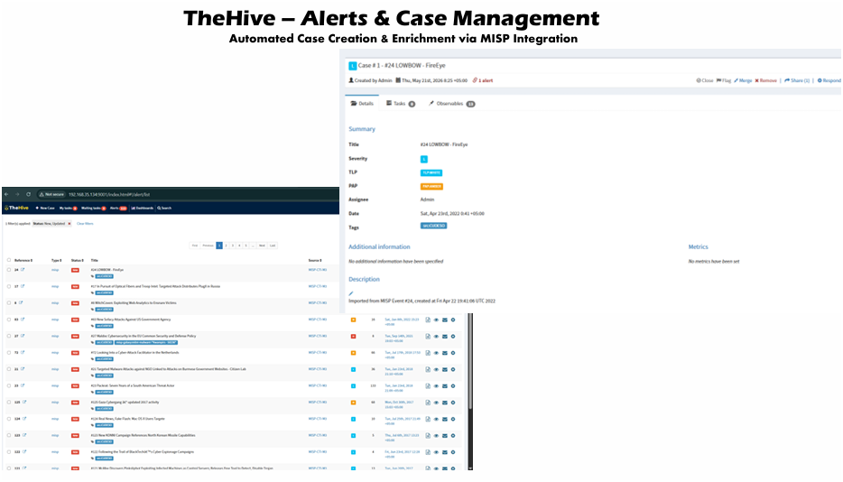 
  TheHive alerts and cases

  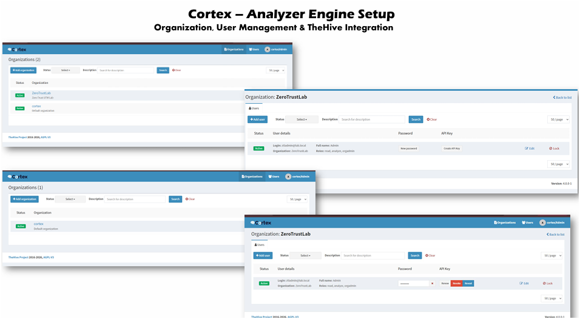 
  Cortex organization, users and TheHive integration

### Dark Web CTI tool

  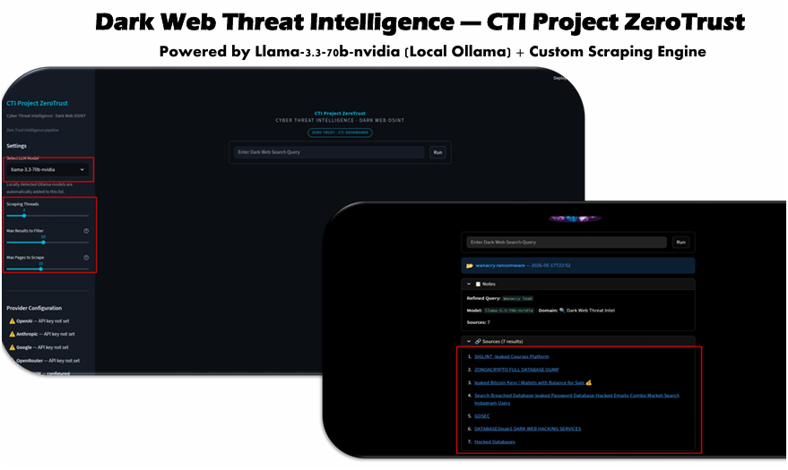

  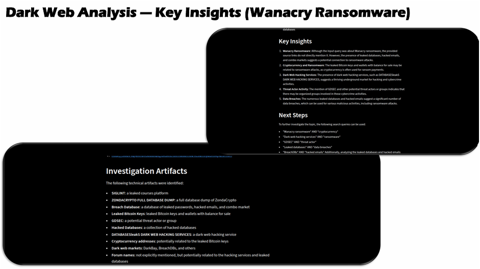 
  Analysis of a WannaCry ransomware search

### Threat intelligence pipeline

  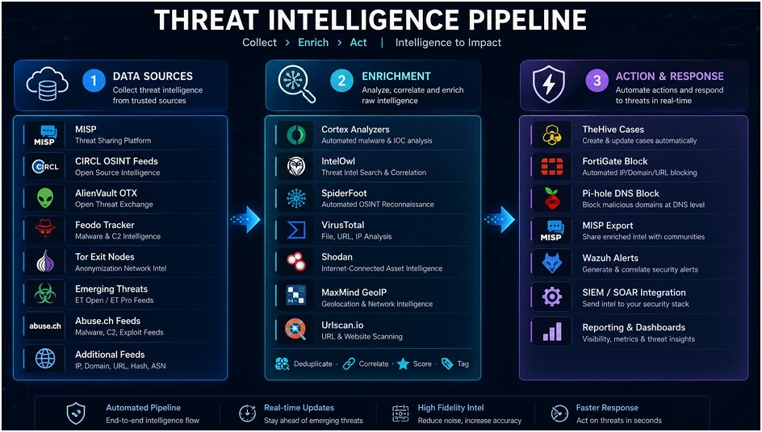

 

## SOAR Workflows

Shuffle SOAR runs four playbooks. The report states an alert-to-action time of under 2 seconds. The FortiGate block workflow editor screenshot still shows two open workflow issues, so that workflow is documented but not fully verified.

  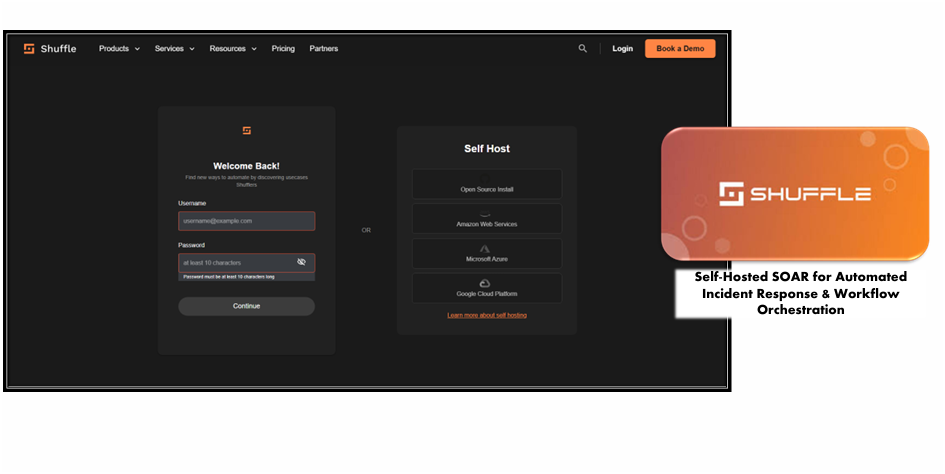

  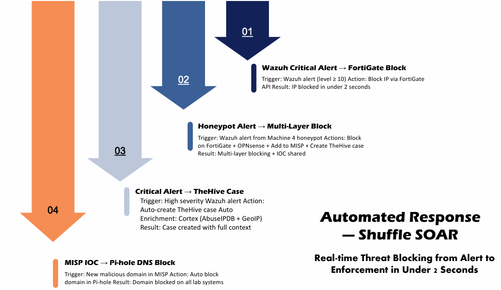

<table>
<tr><th>#</th><th>Workflow</th><th>Trigger</th><th>Action</th></tr>
<tr><td><b>1</b></td><td>Wazuh critical alert → FortiGate block</td><td>Wazuh alert level 10 or above</td><td>Block the source IP through the FortiGate API</td></tr>
<tr><td><b>2</b></td><td>Critical alert → TheHive case</td><td>High-severity Wazuh alert (level 12 or above)</td><td>Create a TheHive case, enriched through Cortex (AbuseIPDB and GeoIP)</td></tr>
<tr><td><b>3</b></td><td>Honeypot alert → multi-layer block</td><td>Interaction with an M4 honeypot</td><td>Block on FortiGate and OPNsense, add the IOC to MISP and create a TheHive case</td></tr>
<tr><td><b>4</b></td><td>MISP IOC → Pi-hole block</td><td>New domain or URL IOC in MISP</td><td>Push the domain to the Pi-hole blocklist</td></tr>
</table>

  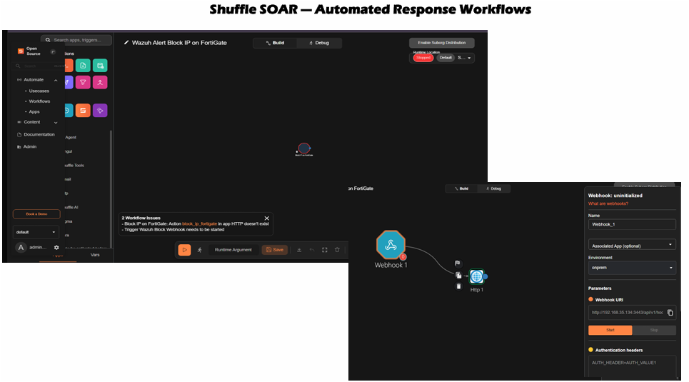

  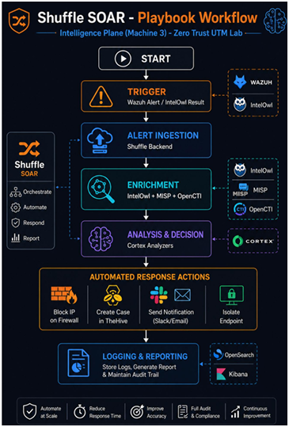

 

## Integration with Other Machines

<table>
<tr><th>Machine</th><th>Integration</th></tr>
<tr><td><b>M1 Network</b></td><td>Receives Suricata, Zeek and firewall logs; SOAR sends block commands to FortiGate and Pi-hole</td></tr>
<tr><td><b>M2 Identity</b></td><td>Receives Keycloak, Vault, RADIUS and certificate logs through Kafka</td></tr>
<tr><td><b>M4 Deception</b></td><td>Receives honeypot logs from four Wazuh agents over Tailscale and triggers the multi-layer block workflow</td></tr>
<tr><td><b>M5 Endpoint</b></td><td>Receives endpoint telemetry: Wazuh agent logs, Sysmon, Auditd, OSQuery and Falco events</td></tr>
</table>

 

## Lab Environment

| | |
|---|---|
| **Platform** | 3 VMs on M3 (32 GB RAM) |
| **Wazuh agents** | 5 active (CTI-M3 and the four M4 honeypots) |
| **Scope** | Isolated lab only |

 

## Full Report

📄 **[Zero-Trust-UTM-Report.pdf](../docs/Zero-Trust-UTM-Report.pdf)**

 

⬅ <a href="../"><b>Back to Main Repository</b></a>

