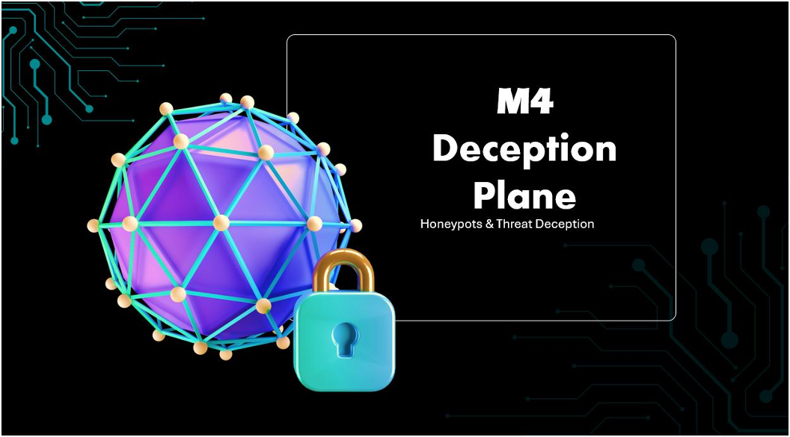
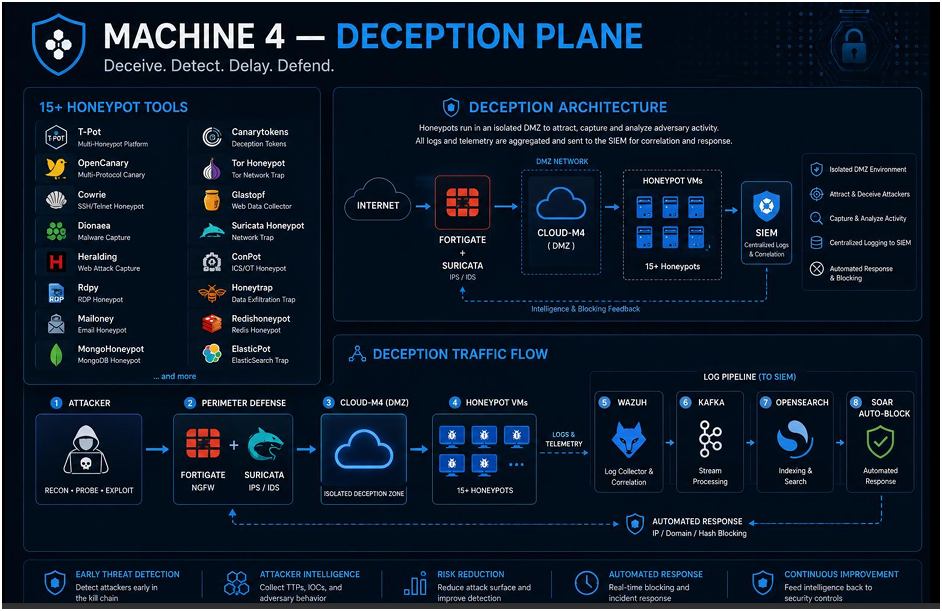
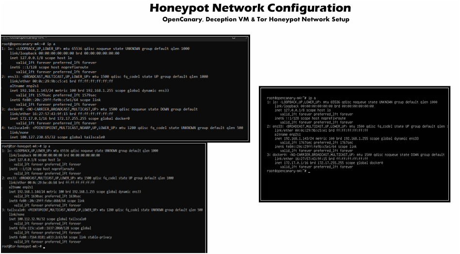
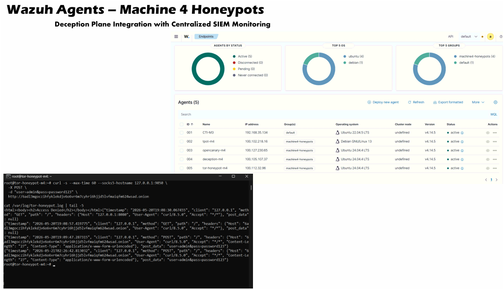

  

<h1>Machine 4 — Deception and Honeypot Plane</h1>
<h3>Deceive, Detect, Delay, Defend: 15+ honeypot tools feeding the SIEM and SOAR pipeline</h3>

 

  

<a href="#architecture"><b>Architecture</b></a> &nbsp;·&nbsp;
<a href="#honeypot-tools"><b>Tools</b></a> &nbsp;·&nbsp;
<a href="#virtual-machines"><b>VMs</b></a> &nbsp;·&nbsp;
<a href="#log-pipeline-and-response"><b>Pipeline</b></a> &nbsp;·&nbsp;
<a href="#integration-with-other-machines"><b>Integration</b></a>

 

---

## Executive Summary

Machine 4 is the deception plane of the Zero Trust UTM project. It runs four honeypot virtual machines with more than 15 honeypot tools inside an isolated DMZ called CLOUD-M4. Its purpose is to draw attackers away from real assets, capture their tactics, techniques and procedures, and feed that intelligence into the SIEM and the automated response pipeline.

Any attacker who reaches M4 is already past the perimeter, and every action they take is recorded, analysed and used to improve the defenses.

> All testing was performed in a private, isolated lab. All IP addresses shown are lab-only values.

 

## Architecture

   
  M4 deception plane: honeypot tools, CLOUD-M4 DMZ, traffic flow and SIEM pipeline

<table>
<tr><th>Stage</th><th>What happens</th></tr>
<tr><td><b>1. Attacker</b></td><td>Recon, probe or exploit activity</td></tr>
<tr><td><b>2. Perimeter</b></td><td>FortiGate and Suricata inspect the traffic</td></tr>
<tr><td><b>3. CLOUD-M4 DMZ</b></td><td>Isolated deception zone, separate from production</td></tr>
<tr><td><b>4. Honeypot VMs</b></td><td>The attacker interacts with one of the 15+ honeypot services</td></tr>
<tr><td><b>5. Wazuh</b></td><td>Agents on all four VMs collect logs</td></tr>
<tr><td><b>6. Kafka and OpenSearch</b></td><td>Logs are streamed, indexed and searchable</td></tr>
<tr><td><b>7. SOAR auto-block</b></td><td>Shuffle blocks IPs and shares IOCs</td></tr>
</table>

 

## Honeypot Tools

<table>
<tr><th>Tool</th><th>Purpose</th></tr>
<tr><td><b>T-Pot</b></td><td>Multi-honeypot platform with a unified Kibana dashboard</td></tr>
<tr><td><b>OpenCanary</b></td><td>Multi-protocol canary for HTTP, FTP, SSH, Telnet, SMB and MySQL</td></tr>
<tr><td><b>Cowrie</b></td><td>SSH and Telnet honeypot that records attacker commands</td></tr>
<tr><td><b>Dionaea</b></td><td>Malware capture over SMB, HTTP, FTP and SIP</td></tr>
<tr><td><b>Heralding</b></td><td>Credential capture across common protocols</td></tr>
<tr><td><b>Rdpy</b></td><td>RDP honeypot</td></tr>
<tr><td><b>Mailoney</b></td><td>SMTP honeypot</td></tr>
<tr><td><b>MongoHoneypot, Redishoneypot, ElasticPot</b></td><td>Exposed database and search honeypots</td></tr>
<tr><td><b>Canarytokens</b></td><td>Deception tokens that alert on access</td></tr>
<tr><td><b>Tor Honeypot</b></td><td>Hidden service that captures dark web interaction</td></tr>
<tr><td><b>Glastopf</b></td><td>Web application honeypot for LFI, RFI and SQL injection</td></tr>
<tr><td><b>ConPot</b></td><td>ICS and OT honeypot (Modbus, S7comm, SNMP)</td></tr>
<tr><td><b>Honeytrap, Suricata honeypot</b></td><td>Arbitrary-port capture and network-level detection</td></tr>
</table>

 

## Virtual Machines

<table>
<tr><th>VM</th><th>Role</th></tr>
<tr><td><b>T-Pot</b></td><td>Flagship multi-honeypot platform (Debian 13) running its services in Docker containers</td></tr>
<tr><td><b>OpenCanary-M4</b></td><td>Multi-protocol canary services</td></tr>
<tr><td><b>Deception-M4</b></td><td>Deception orchestration and token deployment</td></tr>
<tr><td><b>Tor-Honeypot-M4</b></td><td>Tor hidden service that mimics a login portal and logs every request with its headers and submitted data</td></tr>
</table>

   
  Honeypot network configuration for OpenCanary, the deception VM and the Tor honeypot

 

## Log Pipeline and Response

All four VMs run Wazuh agents (version 4.14.5) in the `machine4-honeypots` group and report to the SIEM on M3 over Tailscale.

   
  Wazuh agents for the M4 honeypots, all active

<table>
<tr><th>Item</th><th>Detail</th></tr>
<tr><td><b>Kafka topics</b></td><td><code>honeypot-logs</code> <code>cowrie-logs</code> <code>tpot-logs</code> <code>opencanary-alerts</code> <code>dionaea-logs</code> <code>canarytoken-alerts</code> <code>honeyshare-logs</code></td></tr>
<tr><td><b>Wazuh rules</b></td><td>100400 Cowrie interaction, 100401 SSH login attempt, 100402 command executed</td></tr>
<tr><td><b>SOAR response</b></td><td>Block the source IP on FortiGate and OPNsense, add the IOC to MISP, create a TheHive case</td></tr>
</table>

 

## Integration with Other Machines

<table>
<tr><th>Machine</th><th>Integration</th></tr>
<tr><td><b>M1 Network</b></td><td>FortiGate blocks IPs detected by honeypots and the block lists are updated through the SOAR API</td></tr>
<tr><td><b>M2 Identity</b></td><td>Identity logs are cross-referenced with honeypot interactions to spot compromised credentials</td></tr>
<tr><td><b>M3 Intelligence</b></td><td>Honeypots → Wazuh agent → SIEM → Kafka → OpenSearch → Shuffle SOAR</td></tr>
<tr><td><b>M5 Endpoint</b></td><td>Endpoint agents flag lateral movement toward honeypot addresses</td></tr>
</table>

 

## Key Takeaways

- **Deception gives early detection.** Any interaction with a honeypot is treated as malicious intent.
- **The DMZ is isolated.** Honeypots have no access to production networks.
- **Response is automated.** Honeypot alerts trigger blocking and case creation without manual steps.
- **The Tor honeypot extends coverage** to the dark web with a hidden service.

 

## Lab Environment

| | |
|---|---|
| **Platform** | 4 VMs on M4 (16 GB RAM), connected over Tailscale |
| **Wazuh agents** | 4 active, group `machine4-honeypots` |
| **Scope** | Isolated lab only |

 

## Full Report

📄 **[Zero-Trust-UTM-Report.pdf](../docs/Zero-Trust-UTM-Report.pdf)**

 

⬅ <a href="../"><b>Back to Main Repository</b></a>

