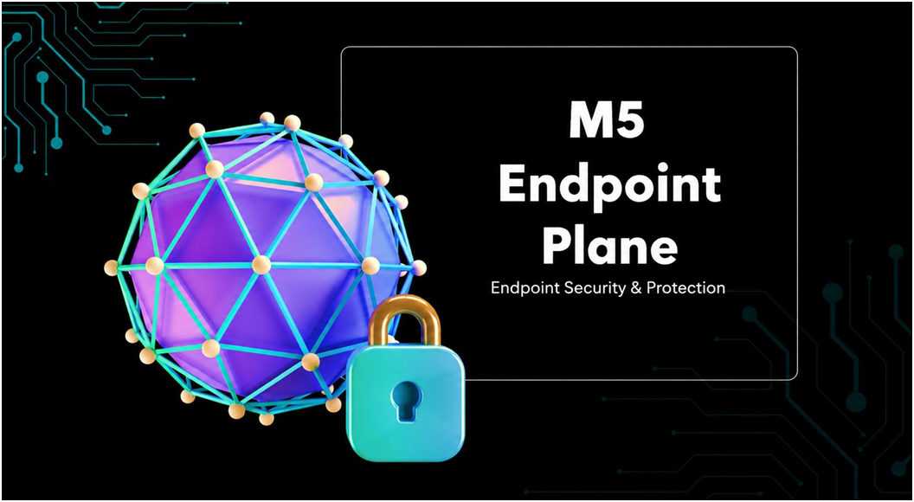
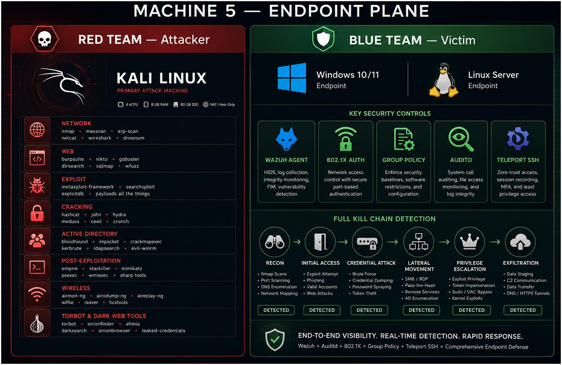
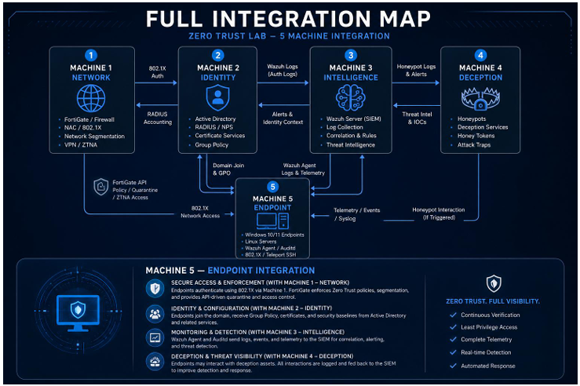

  

<h1>Machine 5 — Endpoint Protection and Hardening Plane</h1>
<h3>Red team versus blue team: attack simulation against monitored, hardened endpoints</h3>

 

  

<a href="#architecture"><b>Architecture</b></a> &nbsp;·&nbsp;
<a href="#red-team"><b>Red Team</b></a> &nbsp;·&nbsp;
<a href="#blue-team"><b>Blue Team</b></a> &nbsp;·&nbsp;
<a href="#integration-with-other-machines"><b>Integration</b></a> &nbsp;·&nbsp;
<a href="#current-status"><b>Status</b></a>

 

---

## Executive Summary

Machine 5 is the endpoint plane of the Zero Trust UTM project. It has two sides: a Kali Linux red team machine that runs attack tools, and blue team endpoints (Windows 10/11 and a Linux server) protected by a Wazuh agent, Auditd, 802.1X, Group Policy and Teleport SSH. The aim is to test whether the other four planes detect a full attack chain against real endpoints.

> **This machine is still in progress.** The design below follows the project report. Evidence screenshots will be added to this folder as testing is completed.

> All testing is performed in a private, isolated lab. All IP addresses shown are lab-only values.

 

## Architecture

   
  M5 endpoint plane: red team tools, blue team controls and kill chain detection

 

## Red Team

Primary attack machine: Kali Linux (4 vCPU, 8 GB RAM, 80 GB SSD, NAT or host-only networking).

<table>
<tr><th>Category</th><th>Tools</th></tr>
<tr><td><b>Network</b></td><td>nmap, masscan, arp-scan, netcat, wireshark, dnsenum</td></tr>
<tr><td><b>Web</b></td><td>burpsuite, nikto, gobuster, dirsearch, sqlmap, wfuzz</td></tr>
<tr><td><b>Exploit</b></td><td>metasploit-framework, searchsploit, exploitdb</td></tr>
<tr><td><b>Cracking</b></td><td>hashcat, john, hydra, medusa, cewl, crunch</td></tr>
<tr><td><b>Active Directory</b></td><td>bloodhound, impacket, crackmapexec, kerbrute, ldapsearch, evil-winrm</td></tr>
<tr><td><b>Post-exploitation</b></td><td>empire, starkiller, mimikatz, psexec, wmiexec</td></tr>
<tr><td><b>Wireless</b></td><td>airmon-ng, airodump-ng, aireplay-ng, wifite, reaver</td></tr>
<tr><td><b>Dark web</b></td><td>torbot, onionfinder, ahmia, darksearch</td></tr>
</table>

 

## Blue Team

<table>
<tr><th>Endpoint</th><th>Role</th></tr>
<tr><td><b>Windows 10/11</b></td><td>Domain-joined victim endpoint</td></tr>
<tr><td><b>Linux server</b></td><td>Victim server endpoint</td></tr>
</table>

<table>
<tr><th>Control</th><th>Purpose</th></tr>
<tr><td><b>Wazuh agent</b></td><td>HIDS, log collection, file integrity monitoring and vulnerability detection</td></tr>
<tr><td><b>802.1X</b></td><td>Port-based network access control through FreeRADIUS on M2</td></tr>
<tr><td><b>Group Policy</b></td><td>Security baselines and software restrictions from Samba AD on M2</td></tr>
<tr><td><b>Auditd</b></td><td>System call auditing, file access monitoring and log integrity</td></tr>
<tr><td><b>Teleport SSH</b></td><td>Zero-trust access with session recording, MFA and least privilege</td></tr>
</table>

 

## Kill Chain Test Plan

<table>
<tr><th>Stage</th><th>Attack activity</th><th>Expected detection</th></tr>
<tr><td><b>1. Reconnaissance</b></td><td>Nmap scans, port scanning, DNS enumeration</td><td>M1 Suricata and Zeek, Wazuh</td></tr>
<tr><td><b>2. Initial access</b></td><td>Exploit attempts, phishing, web attacks</td><td>FortiGate IPS, Wazuh</td></tr>
<tr><td><b>3. Credential attack</b></td><td>Brute force, credential dumping, password spraying</td><td>Wazuh, Auditd, 802.1X rejection</td></tr>
<tr><td><b>4. Lateral movement</b></td><td>SMB or RDP, pass-the-hash</td><td>Wazuh agent patterns, honeypot interaction</td></tr>
<tr><td><b>5. Privilege escalation</b></td><td>Token impersonation, sudo or UAC bypass</td><td>Auditd, Wazuh vulnerability detection</td></tr>
<tr><td><b>6. Exfiltration</b></td><td>Data staging, C2, DNS or HTTPS tunnels</td><td>Zeek and RITA, FortiGate, Pi-hole</td></tr>
</table>

The report records all six stages as detected. Screenshots and logs proving each stage are still to be added here.

 

## Integration with Other Machines

   
  Full integration map across the five machines

<table>
<tr><th>Machine</th><th>Integration</th></tr>
<tr><td><b>M1 Network</b></td><td>Endpoints authenticate with 802.1X; traffic passes the FortiGate web filter and DNS goes through Pi-hole</td></tr>
<tr><td><b>M2 Identity</b></td><td>Domain join, Group Policy, Step-CA certificates and Teleport SSH</td></tr>
<tr><td><b>M3 Intelligence</b></td><td>Wazuh agent and Auditd telemetry flow to the SIEM through Kafka</td></tr>
<tr><td><b>M4 Deception</b></td><td>Endpoint interaction with honeypot addresses is logged and fed to the SIEM</td></tr>
</table>

 

## Current Status

| Item | Status |
| ---- | ------ |
| Design and architecture | Documented |
| Endpoint controls | Documented in the report, evidence being collected |
| Kill chain test evidence | In progress |
| Demonstration video | To be added |

 

## Full Report

📄 **[Zero-Trust-UTM-Report.pdf](../docs/Zero-Trust-UTM-Report.pdf)**

 

⬅ <a href="../"><b>Back to Main Repository</b></a>

